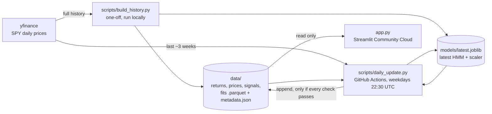

# Walk-Forward Market Regime Detection (S&P 500)

A three-state Gaussian hidden Markov model that labels each trading day of SPY as
**Calm**, **Normal** or **Stressed**, using only information available at that day's
close. A scheduled job extends the history every trading day, and a Streamlit app
shows the current regime.

**Live app:** _link coming soon_ <!-- replace with the Streamlit Community Cloud URL -->

> A research project, not investment advice.

## Architecture



- **`data/returns.parquet`** (daily log returns) is the source of truth. yfinance
  rescales the whole adjusted-price history after every dividend, so newly downloaded
  prices can't be appended to saved ones. Log returns are unaffected by that rescaling.
  `prices.parquet` is rebuilt from returns and used only for the chart.
- **The daily job** downloads the last ~3 weeks of prices and checks that returns on
  overlapping days match the stored ones within 2e-5. Fresh downloads differ by at most
  ~2e-6, and a missed dividend moves a return by ~3e-3. It also checks that the dates
  are exactly the NYSE trading days, with no duplicates, no non-positive prices and no
  shrinking history. It then appends the new days, refitting on the 10-day schedule.
  Files are written to temporary names and swapped in only after every check and write
  succeeds. On any failure the job exits 1, the workflow fails, and nothing is committed.
- **The app** never calls yfinance or fits anything; it reads `data/` only.

## Method

1. **Data.** SPY daily adjusted closes from 2000-01-01 (yfinance, `auto_adjust=True`),
   with no end date.
2. **Features.** The daily log return, and the 21-day rolling standard deviation of log
   returns.
3. **Walk-forward.** An expanding window with a 1,250-day burn-in. Every 10 trading days
   the model is refit on all data before that day. Features are standardised with a
   scaler fitted on the same training window.
4. **Model.** `GaussianHMM(n_components=3, covariance_type="full", n_iter=1000, tol=0.01,
   min_covar=0.001)`, fitted from five seeds (42–46). The fit with the highest
   log-likelihood is kept.
5. **Labels.** After each refit, the states are ranked by their raw (unscaled) mean
   21-day volatility: lowest is **Calm**, middle is **Normal**, highest is **Stressed**.
6. **Filtered probabilities.** For each day *t*, the latest model refit at or before
   *t* is run on features up to and including *t* (`predict_proba`, last row). No later
   data is used.
7. **Rule.** Hold SPY unless the most likely state is Stressed; otherwise hold cash. The
   signal at one close is applied from the next trading day, and each switch costs
   5 bps (a parameter).
8. **Metrics.** Computed in `src/metrics.py`: Sharpe (annualised mean daily log return
   divided by annualised standard deviation, with a **0% risk-free rate**), annual
   volatility, total return, CAGR, max drawdown, number of switches and % of time
   invested.
9. **Reproducibility.** BLAS/OpenMP threads are pinned to 1 before numpy loads, and
   dependency versions are pinned. Two runs on the same stored returns produce
   byte-identical outputs.

## What changed from v1, and why

The original analysis is kept unchanged in `main.ipynb`. Rerunning it exposed five
problems:

| v1 problem | Why it mattered | v2 fix |
|---|---|---|
| **Results were not reproducible.** Reruns of the notebook on identical data gave different signals and a different Sharpe ratio from the one reported. | Multithreaded BLAS and a single EM starting point. Tiny float differences in re-downloaded prices were also enough to move one refit to a different local optimum. | Single-threaded BLAS, five EM starts keeping the best log-likelihood, stored returns as the source of truth, pinned versions. |
| **Unstable state labels.** The "bull" state was the one with the highest mean return divided by mean *standardised* volatility. That mean is usually negative after scaling, so the ratio's sign and size were close to arbitrary. | Which state counted as "bull" could flip between refits for no economic reason. | States are ranked by raw mean volatility after every refit: Calm, Normal, Stressed. |
| **Block Viterbi decoding.** Each 10-day block was decoded on its own, without the history before it. | A day's state depended on where it fell within the block, and the method could not be run one day at a time. | Filtered probabilities for each day from all data up to that day. |
| **No NBER check, despite the claim.** The old README said the model "successfully identified and exited" the 2008 and 2020 crises, but nothing in the notebook checked this. | An unsupported claim. | An explicit check against NBER recession dates (below). |
| **Wrong max drawdown figure.** The walk-forward max drawdown in the old README was never computed by the notebook, and recomputing it from v1's own walk-forward returns gives a much deeper drawdown. Some other headline statistics in the old README came from the *in-sample* baseline model, not the walk-forward. | The risk profile was overstated. | Every number here is produced by the current code and stored in `data/metadata.json`. |

v1 also traded rule "invested only in the bull state". v2 tested two rules, *invested
only when Calm* and *invested unless Stressed*, and kept the second. In that comparison,
made with a single EM start before multi-start was added, the first rule switched about
five times as often and had a lower Sharpe ratio after costs.

## Results

Out of sample, **2005-01-26 to 2026-11-25** (5,494 trading days), 5 bps per switch. The
live app shows the same table updated daily.

| | Buy-and-hold SPY | Strategy (gross) | Strategy (net) |
|---|---|---|---|
| Sharpe ratio (rf = 0%) | 0.53 | 0.75 | **0.74** |
| Annual volatility | 18.9% | 12.4% | 12.4% |
| Total return | 811% | 666% | 646% |
| CAGR | 10.65% | 9.77% | 9.64% |
| Max drawdown | −55.2% | −28.5% | **−28.9%** |
| Switches | 0 | 52 | 52 |
| Time invested | 100% | 83% | 83% |

The strategy gives up about one percentage point of CAGR for a lower volatility and
roughly half the maximum drawdown.

**NBER check.** These are the shares of days whose most likely state was Stressed. NBER
dates recessions by month; a recession runs from the month after the peak through the
trough month, the same convention as FRED's `USREC` series. Dates and source are in
`data/nber_recessions.csv`.

| Period | Trading days | Stressed |
|---|---|---|
| All recession days | 420 | **78%** |
| All other days | 5,075 | **12%** |
| 2008-01 to 2009-06 | 377 | 75% |
| 2020-03 to 2020-04 | 43 | 100% |

**Model fitting.** 550 refits, with no failed fits, none hitting the iteration cap, and
no warnings of falling log-likelihood. In 438 refits a seed other than 42 gave the best
fit.

## Limitations

- **Only two recessions are tested.** The 2001 recession falls inside the burn-in, so the
  NBER check rests on 2008–09 and 2020. Treat it as a sanity check, not validation.
- **Early 2008 is often not flagged as Stressed.** The highest-likelihood fits label much
  of early 2008 Normal: 52% of January days are Stressed, 0% in May and June, and 41% in
  July. Every day from August 2008 to May 2009 is Stressed. This fits market stress
  lagging the official NBER start date (December 2007 peak), but it does mean the model
  is not an early-warning recession indicator.
- **Stressed is about volatility, not recessions.** About 12% of non-recession days are
  Stressed, for example during sharp sell-offs outside recessions.
- **Simple costs and returns.** A flat cost per switch, no slippage or taxes, no interest
  earned on cash, and a Sharpe ratio on log returns with a 0% risk-free rate.
- **Data source.** yfinance is unofficial and can change or break. The daily job fails
  loudly rather than writing questionable data, but it then needs someone to look at it.
- **Platform.** The stored history was built on macOS (Apple Accelerate). Daily refits run
  on Linux (OpenBLAS), so floating-point details of future refits can differ slightly from
  what a Mac would compute. Stored rows are never recomputed.
- **Scheduled workflows** in public repositories are disabled by GitHub after 60 days
  without repository activity. GitHub doesn't define what counts as activity. The daily
  data commits are expected to keep the schedule alive, but if the job fails for weeks
  (no commits), check the Actions tab and re-enable the workflow if needed.

## Running it locally

Requires Python 3.12.

```bash
git clone https://github.com/Parstaz/Walk-Forward-Market-Regime-Detection-S-P-500.git
cd Walk-Forward-Market-Regime-Detection-S-P-500
python3.12 -m venv .venv && source .venv/bin/activate
pip install -r requirements-dev.txt

python -m pytest                    # validation, failure-safety and incremental-update tests
streamlit run app.py                # the app, reading the committed data/
python scripts/daily_update.py      # append any new trading days (seconds)
python scripts/run_backtest.py      # full backtest printed as a table, nothing saved (~15 min)
python scripts/build_history.py     # rebuild data/ and models/ from scratch (~15 min)
```

`build_history.py` replaces the stored history. The scheduled job only ever appends to it.

## Repository layout

| Path | What it is |
|---|---|
| `src/` | `data.py` (yfinance), `features.py`, `model.py` (HMM, multi-start, labels, filtered probabilities), `backtest.py` (walk-forward, rule, costs), `metrics.py` (metrics, NBER check), `pipeline.py` (storage, validation, build, daily update) |
| `scripts/` | `build_history.py`, `daily_update.py`, `run_backtest.py` |
| `app.py` | Streamlit app |
| `data/` | Stored history, metadata, NBER dates |
| `models/` | Latest fitted model |
| `tests/` | pytest suite |
| `.github/workflows/` | `daily.yml` (scheduled update), `tests.yml` (CI) |
| `main.ipynb` | The original v1 notebook, unchanged |
